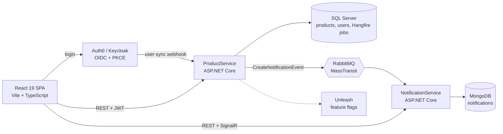

# InMarket

[](https://github.com/raman-hrynevich/InMarket/actions/workflows/build.yml)
[](https://sonarcloud.io/summary/new_code?id=LifelesSoul_InMarket)
[](https://sonarcloud.io/summary/new_code?id=LifelesSoul_InMarket)

<!-- If you rename the SonarCloud project, update the project key in both badges. -->

A multi-vendor marketplace built as .NET services: sellers list products, buyers browse them, and everyone gets real-time notifications. The focus is on the parts that are hard in production — asynchronous messaging that survives failures, two identity providers running side by side, and role- and owner-based access control.

## About this project

InMarket is a personal project I build in my own time to explore marketplace architecture outside of work — things that are hard to try on a production system. It is written from scratch and contains no code, data or configuration from any employer or client.

The technical choices here are deliberately different from the stack I use in commercial work:

- **Two identity providers side by side** — Auth0 and Keycloak, with the login flow switched by an Unleash feature flag, to practise moving users between providers without downtime
- **Feature-flagged rollouts** with a self-hosted Unleash server
- **Real-time notifications** pushed to the right user over SignalR
- **Polyglot persistence** — SQL Server for relational data, MongoDB for notifications
- **Background jobs with Hangfire** for publishing events after a write
- **React with hooks and context** instead of a global Redux store
- **Self-hosted infrastructure in Docker** instead of managed cloud services

<!-- Add a 30–60 second GIF here: log in → become a seller → create a product → notification pops up. -->
<!--  -->

## Architecture



| Service | Responsibility | Storage |
| --- | --- | --- |
| **ProductService** | Products, categories, users and profiles; buyer/seller/admin roles; owner checks on products | SQL Server (EF Core migrations) |
| **NotificationService** | Consumes events, stores notifications, pushes them to the right user over SignalR | MongoDB |
| **frontend** | Storefront, seller product management, admin categories, profile | — |

## Key engineering decisions

- **Asynchronous notifications.** ProductService never calls NotificationService directly. It publishes `CreateNotificationEvent` through MassTransit/RabbitMQ, so a slow or unavailable notification service does not affect product writes.
- **Publishing tied to the write.** The event is enqueued as a Hangfire job (SQL Server storage) inside the same `TransactionScope` as the product change, so a rolled-back change does not produce a notification.
  <!-- Double-check that Hangfire.SqlServer enlists in the ambient transaction with your configuration before keeping this claim. -->
- **Failure handling.** The consumer retries with a fixed interval; messages that still fail land in a dead-letter queue, and a background service re-drives them.
- **Two identity providers side by side.** The API selects the JWT scheme by the token's issuer (Auth0 or Keycloak), Keycloak roles are mapped to app roles by a claims transformation, and `GET /api/auth/login-url` returns Auth0 or Keycloak settings depending on the Unleash flag `use-keycloak-auth`. The SPA switches provider without a redeploy, and tokens from both providers stay valid during the move.
- **Separate stores per workload.** Relational data (products, users, roles) lives in SQL Server; notifications are append-heavy and schema-light, so they live in MongoDB.
- **Authorization beyond roles.** Roles are a `[Flags]` enum (Buyer, Seller, Admin); sellers can change only their own products, and users can read only their own notifications (resource-based authorization handler).

<!-- Move each decision into docs/adr/000N-*.md (context → decision → alternatives → consequences) and link it here. -->

## Features

- Sign-in with Auth0 or Keycloak (Authorization Code + PKCE, silent SSO)
- Buyer → seller upgrade from the profile page
- Seller product management with validation and statuses (Draft, Available, Sold, Removed)
- Admin category management
- Real-time notifications over SignalR
- OpenAPI with Scalar UI for ProductService, Swagger UI for NotificationService

## Tech stack

- **Backend:** .NET 9, ASP.NET Core, EF Core, SQL Server, MongoDB, MassTransit, RabbitMQ, Hangfire, SignalR, FluentValidation, AutoMapper
- **Identity & flags:** Auth0, Keycloak, JWT, Unleash
- **Frontend:** React 19, TypeScript, Vite, React Router
- **Quality:** xUnit, Moq, Shouldly, SonarCloud, GitHub Actions
- **Infrastructure:** Docker, Docker Compose

## Project structure

```text
ProductService/
  ProductService/            API: controllers, auth, middleware, MassTransit and Hangfire setup
  ProductService.BLL/        services, validators, mapping, events
  ProductService.DAL/        EF Core DbContext, repositories, migrations, seeding
  ProductService.Domain/     entities, enums, constants
  ProductService.UnitTests/  xUnit tests
NotificationService/
  NotificationService/                 API, SignalR hub route, auth
  NotificationService.Application/     consumer, hub, DLQ retry service
  NotificationService.Infrastructure/  MongoDB repository
  NotificationService.Domain/          entities, exceptions
frontend/                    React SPA (features: Auth, Product, Category, Profile)
docker-compose.yml           SQL Server, Keycloak, Unleash (+ Postgres for Unleash)
```

## Run locally

Prerequisites: .NET 9 SDK, Node.js (version supported by Vite 7), Docker.

```bash
# 1. Infrastructure: SQL Server, Keycloak, Unleash
docker compose up -d

# 2. RabbitMQ and MongoDB (not in docker-compose.yml yet)
docker run -d --name rabbitmq -p 5672:5672 -p 15672:15672 rabbitmq:3-management
docker run -d --name mongodb -p 27017:27017 mongo

# 3. Services (configure Auth0/Keycloak/Unleash settings in appsettings.Development.json or user-secrets)
dotnet run --project ProductService/ProductService            # http://localhost:5010, API docs at /scalar
dotnet run --project NotificationService/NotificationService  # http://localhost:5083, Swagger at /swagger

# 4. Frontend (set VITE_API_URL, VITE_AUTH0_*, VITE_KEYCLOAK_URL in frontend/.env.local)
cd frontend && npm ci && npm run dev
```

<!-- Target state: one `docker compose up` that starts everything, with pinned image versions and a .env.example. Update this section when done. -->

## Testing

```bash
dotnet test ProductService/ProductService.sln
```

95 unit tests cover ProductService business services, AutoMapper profiles, the auth scheme selector and the Keycloak role transformation. Every push and pull request to `main` runs the tests with coverage and a SonarCloud analysis.

## Roadmap

- [ ] Upgrade to .NET 10 (LTS)
- [ ] Full stack in one `docker compose up`, pinned image versions, `.env.example`
- [ ] Integration tests with Testcontainers (SQL Server, RabbitMQ, MongoDB)
- [ ] NotificationService and frontend in CI
- [ ] Transactional Outbox via MassTransit EF Core
- [ ] OpenTelemetry tracing across services

## License

MIT
